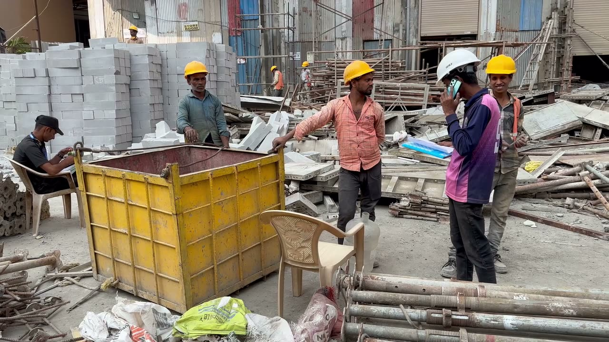

# SiteGuard: PPE Detection with YOLO26

[](https://github.com/Ibrahim278/PPE-Detection-using-Computer-Vision-and-YOLO26S/actions/workflows/ci.yml)
**Live demo:** [siteguardx.vercel.app](https://siteguardx.vercel.app)

This started as a course project for **CST8508 Machine Vision at Algonquin College**: fine-tune a YOLO model to
tell construction workers wearing hard hats from workers with bare heads. It has since grown into **SiteGuard**, an
end-to-end hard-hat compliance system. It tracks every worker in a video or camera feed, confirms a violation
only when a bare head persists, logs each incident with a snapshot, and presents everything in a web dashboard.

<p align="center"></p>

## Contents

- [From course project to SiteGuard](#from-course-project-to-siteguard)
- [Features](#features)
- [How it works](#how-it-works)
- [Model and results](#model-and-results)
- [Repository structure](#repository-structure)
- [Run locally with Docker](#run-locally-with-docker)
- [Development setup](#development-setup)
- [Deployment](#deployment)
- [Training and evaluation](#training-and-evaluation)
- [Limitations](#limitations)
- [Acknowledgements](#acknowledgements)

---

## From course project to SiteGuard

**The course project (v2)** is a single Google Colab notebook, [`PPE_Detection_Project_Code.ipynb`](PPE_Detection_Project_Code.ipynb).
It parses the Kaggle annotations, converts them to YOLO format, fine-tunes YOLO26s on three classes (`helmet`,
`head`, `person`), evaluates on a held-out test set, and runs the model on construction videos. The course write-up
is in `Project Report.docx` and `Project Presnetation.pptx`, and the original outputs are kept in
`Training and Validation/ppe_yolo26s_v2/`, `Evaluation and Testing/` and `Project Demo Videos/`.

**What was built on top**, in four phases:

| Phase | What it added | Where |
|---|---|---|
| 1. Model and tracking | 2-class model (v3), retrained on the same split; people come from a pretrained COCO detector; ByteTrack tracking, temporal smoothing and one event per violation; tuned per-class thresholds; ONNX export | [`ml/`](ml/README.md) |
| 2. Backend API | FastAPI service: image detection, video jobs from uploads or links, live WebSocket stream, events stored in SQLite | [`api/`](api/README.md) |
| 3. Web app | React + Tailwind dashboard: landing page, Live Monitor, Analyze, Violations, Model, with charts | [`web/`](web/README.md) |
| 4. Shipping | Docker images and Compose stack, GitHub Actions CI, hosting on Vercel (frontend) and Render (API) | [`DEPLOY.md`](DEPLOY.md) |

## Features

- **Live Monitor:** use a webcam, or play a recording as if it were a camera. Boxes are drawn over the video, alongside a live compliance count, trend sparklines and a violation feed with snapshots.
- **Analyze:** check a photo instantly, or upload a video (MP4, MOV, AVI, MKV, WebM) or paste a YouTube, Vimeo or direct link, optionally just a section. You get an annotated MP4, compliance over time, a per-worker violation timeline, and each incident with a snapshot.
- **Violations dashboard:** every incident from videos and live sessions, with filters, an incidents-over-time chart, a weekday × hour heatmap and CSV export.
- **Model page:** test-set metrics, v2 vs v3, per-class results, thresholds, and how alerts are decided.

## How it works

1. **Detect:** YOLO26s finds every head and whether it wears a hard hat. A COCO model finds people, so workers whose head isn't visible still count.
2. **Track:** ByteTrack keeps a stable ID per worker across frames.
3. **Confirm:** a violation opens only after about 1.5 s of a bare head on the same worker, and closes after 1 s with a helmet or 2 s out of view.
4. **Alert and log:** each incident is stored with a snapshot, start time and duration.

```
Browser (React, Vercel) ──HTTPS / WebSocket──► API (FastAPI on Render)
                                                 ├─ YOLO26s + COCO person model + ByteTrack
                                                 ├─ background video jobs (ffmpeg, yt-dlp)
                                                 └─ SQLite + annotated videos + snapshots on a disk
```

## Model and results

**Dataset:** [Safety Helmet Detection](https://www.kaggle.com/datasets/andrewmvd/hard-hat-detection) on Kaggle. It has 5,000 images (about 416×416) with Pascal VOC annotations: 18,966 `helmet`, 5,785 `head` and 751 `person` boxes. Both versions use the same 70/20/10 train/val/test split (3,499 / 999 / 502 images).

**v2, the course model (3 classes, test set, conf 0.4):** strong on helmets and heads, but the `person` class failed because it had too few, inconsistent labels, which pulled the overall score down.

| | Overall | `helmet` | `head` | `person` |
|---|---|---|---|---|
| mAP@50 | 0.643 | 0.970 | 0.950 | 0.008 |
| mAP@50-95 | 0.434 | 0.652 | 0.644 | 0.005 |

**v3, the current model (2 classes) vs v2, on the same 502 test images (helmet + head):**

| Model | mAP@50 | mAP@50-95 | Precision | Recall |
|---|---|---|---|---|
| v2 | 0.963 | 0.635 | 0.942 | 0.918 |
| **v3** | **0.963** | **0.639** | 0.932 | **0.926** |

Accuracy is effectively a tie. v3's gains are in the system around the model: no broken `person` class, tracking,
confirmed alerts and tuned thresholds (helmet 0.39, head 0.45). v3 was trained for 100 epochs (best epoch 86) at
640 px on an Apple M5. The weights are in `Training and Validation/ppe_yolo26s_v3/weights/` (PyTorch and ONNX, via
Git LFS), and the metrics and demo outputs are in `Evaluation and Testing/v3/`.

**Speed:**
- Apple M5 GPU (MPS): 11 ms per frame, detector only.
- CPU in Docker: about 9 FPS for live tracking with both models.
- Hosted demo on 1 CPU: about 1 s per image.

## Repository structure

```
├── ml/                          # Python package: data prep, training, evaluation, tracking, export (Phase 1)
├── api/                         # FastAPI backend + Dockerfile (Phase 2)
├── web/                         # React + Tailwind frontend + Dockerfile / nginx (Phase 3)
├── docker-compose.yml           # full stack locally
├── render.yaml                  # Render blueprint for the API
├── DEPLOY.md                    # detailed hosting guide
├── .github/workflows/ci.yml     # tests, builds, image publishing
├── PPE_Detection_Project_Code.ipynb   # original course notebook (v2)
├── Config Files/                # v2 training / validation configs
├── Training and Validation/     # v2 and v3 runs: weights, curves, configs
├── Evaluation and Testing/      # v2 metrics and samples; v3/ metrics, thresholds, demo videos
├── Project Demo Videos/         # v2 annotated demo clips
└── Project Report.docx, Project Presnetation.pptx   # course deliverables
```

## Run locally with Docker

Requires Docker and Git LFS.

```bash
git clone https://github.com/Ibrahim278/PPE-Detection-using-Computer-Vision-and-YOLO26S
cd PPE-Detection-using-Computer-Vision-and-YOLO26S
git lfs pull --include="Training and Validation/ppe_yolo26s_v3/weights/best.pt"
docker compose up --build
```

Open <http://localhost:8080>. nginx serves the web app and proxies `/api` and `/media` to the API, which isn't exposed
directly. Data (database, videos, snapshots) persists in the `ppe-data` volume. The image runs on CPU. For real-time
Live Monitor, run the development setup on a machine with a GPU.

## Development setup

**Backend** (Python 3.10+, ffmpeg):

```bash
python -m venv .venv && source .venv/bin/activate
pip install -e ml -e "api[platforms,dev]"
git lfs pull --include="Training and Validation/ppe_yolo26s_v3/weights/best.pt"
cd api && uvicorn app.main:app --reload --port 8000      # docs at http://localhost:8000/docs
```

It uses Apple MPS or CUDA automatically when available. Endpoints, the WebSocket protocol and settings are in [`api/README.md`](api/README.md).

**Frontend** (Node 20):

```bash
cd web && npm install && npm run dev                     # http://localhost:5173, proxies /api to :8000
```

**Tests:** `pytest ml/tests api/tests`. CI also type-checks and builds the web app, audits npm packages, builds both
Docker images and smoke-tests the stack on every push.

## Deployment

The live demo runs as two services. Step-by-step instructions are in [`DEPLOY.md`](DEPLOY.md).

**Frontend on Vercel**
- Import the repository and set **Root Directory** to `web`. `web/vercel.json` sets the build, SPA routing and headers.
- Set `VITE_API_URL` to the API's URL, then redeploy. The value is built into the site.
- Leave Git LFS off in Vercel; the frontend doesn't need the model files.

**Backend on Render**
- CI builds the API image with the model weights and publishes it to `ghcr.io/ibrahim278/siteguard-api` on every push to `main`.
- *New → Blueprint* reads [`render.yaml`](render.yaml): Standard plan (1 CPU, 2 GB RAM), a 5 GB disk at `/data`, and a health check.
- Set `PPE_CORS_ORIGINS` to the Vercel URL.
- Optionally, add the service's Deploy Hook as the GitHub secret `RENDER_DEPLOY_HOOK_URL`, so each green CI run deploys automatically.

**Any other Docker host** works as well: build `api/Dockerfile` from the repository root, mount `/data`, and
serve the frontend from `web/Dockerfile` or any static host. Settings are listed in [`api/README.md`](api/README.md#configuration-environment-variables).

## Training and evaluation

The original workflow is the Colab notebook. The [`ml/`](ml/README.md) package makes it reproducible from the command line:

```bash
cd ml
python -m ppe.data.prepare                                   # download (Kaggle CLI) and build the 2-class dataset
python -m ppe.train --config configs/train_v3.yaml           # train (resumes from last.pt)
python -m ppe.evaluate --weights <best.pt> --out outputs/eval    # metrics + tuned thresholds
python -m ppe.monitor --source video.mp4 --out outputs/run       # annotated MP4 + violation events
```

## Limitations

- **Hard hats only:** caps count as violations, but improvised head coverings (such as paper bags) can be mistaken for helmets. Vests, glasses and other PPE aren't checked.
- **Frame rate:** live tracking needs about 10 FPS or more. The hosted CPU demo is best used for image and video analysis.
- **No login yet:** keep a deployment private, or add authentication, before sharing it widely.
- **A demonstration, not a certified safety system:** check privacy rules before recording real sites.

## Acknowledgements

- CST8508 Machine Vision, Algonquin College, where this project began.
- [Safety Helmet Detection dataset](https://www.kaggle.com/datasets/andrewmvd/hard-hat-detection) (Kaggle, andrewmvd).
- [Ultralytics YOLO](https://github.com/ultralytics/ultralytics) and ByteTrack.
- Demo footage from [Pexels](https://www.pexels.com) (free licence).
